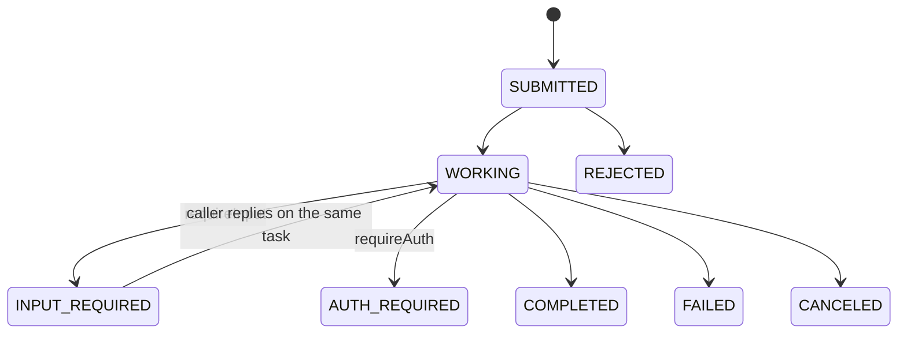

# Agents

Tools are functions. **Agents** are peers you hold a conversation with: you send a message, and
an agent either replies directly or starts a **task** that moves through states, produces
**artifacts**, and may pause to ask you for more input. A2A is the protocol AgentWeave uses for
agents; the agent model in `agentweave-core` is protocol-neutral.

## Task states

`TaskState` has these values:

- `SUBMITTED`
- `WORKING`
- `INPUT_REQUIRED` and `AUTH_REQUIRED`, the *interrupted* states: the task waits for the caller.
- `COMPLETED`, `FAILED`, `CANCELED` and `REJECTED`, the *terminal* states.
- `UNKNOWN`



## Serving an agent

Implement `AgentHandler`. The `AgentTaskContext` reports progress and results as they happen; when
the client streams, it sees them live.

```java
AgentHandler travel = (request, task) -> {
    if (!request.resumed()) {
        task.requireInput("Which city are you flying to?");   // pauses the task
        return;
    }
    task.working("Searching flights to " + request.text());
    task.artifact("itinerary", List.of(new Content.Text("OSL → " + request.text() + ", 09:40")));
    task.complete("Booked.");
};
```

The rules:

- Call `task.reply(...)` to answer with a single message and create no task.
- If the handler returns without finishing or pausing, the task completes automatically.
- If the handler throws, the task fails, with the exception message as the reason.
- `request.caller()` is the authenticated `CallerIdentity`. `task.isCancelled()` turns `true`
  when the caller cancels.

The A2A module serves an `AgentHandler` over A2A, and the LangChain4j module turns a LangChain4j
AI service into one.

## Talking to an agent

An `AgentConnector` sends messages to a remote agent:

```java
AgentReply reply = agent.send(AgentMessage.user("Book me a flight"));
if (reply.state() == TaskState.INPUT_REQUIRED) {
    reply = agent.send(AgentMessage.userReply(reply.taskId(), reply.contextId(), "Berlin"));
}
System.out.println(reply.text());   // the message text plus any artifact text
```

`send(message, events)` streams `AgentEvent`s (`StatusUpdate`, `ArtifactUpdate`,
`MessageReceived`) while the agent works. The connector also provides `getTask(taskId)` and
`cancel(taskId)`.

## Agents as tools

To let a tool-calling model reach agents, register the agent connector in a `ToolRegistry`. It
appears as a single tool, `<name>.ask`. A2A agents receive messages rather than per-skill calls,
so one tool reflects the protocol honestly. If the agent needs more input, the tool result holds
its question and `{task_id, context_id, state}`, so the caller can answer on the next call.
