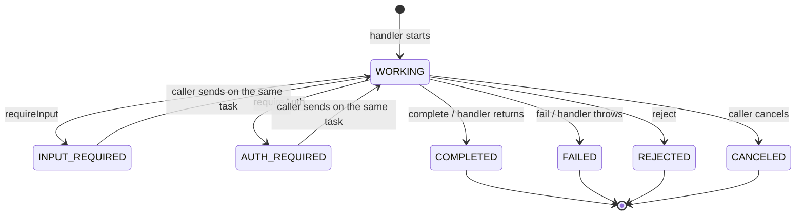

# Agents

Tools are functions. **Agents** are peers you hold a conversation with: you send a message, and an
agent either replies directly or starts a **task** that moves through states, produces
**artifacts**, and may pause to ask you for more input. The agent model in `agentweave-core` is
protocol-neutral; [A2A](../protocols/a2a.md) is the protocol that carries it.

## Task states

`TaskState` has these values:

| State | Kind | Meaning |
|---|---|---|
| `SUBMITTED` | | Accepted, not started. |
| `WORKING` | | In progress. |
| `INPUT_REQUIRED` | interrupted | Waiting for the caller to send more input on the same task. |
| `AUTH_REQUIRED` | interrupted | Waiting for the caller to authenticate. |
| `COMPLETED` | terminal | Finished successfully. |
| `FAILED` | terminal | Finished with an error. |
| `CANCELED` | terminal | Canceled by the caller. |
| `REJECTED` | terminal | The agent declined the work. |
| `UNKNOWN` | | The peer reported a state AgentWeave doesn't know. |

`isTerminal()` and `isInterrupted()` classify a state.



## Serving an agent

Implement `AgentHandler`. One handler serves every task, and each call runs on its own thread. The
`AgentTaskContext` reports progress and results as they happen; a streaming client sees them live.

```java
AgentHandler travel = (request, task) -> {
    if (!request.resumed()) {
        task.requireInput("Which city are you flying to?");   // pauses the task
        return;
    }
    task.working("Searching flights to " + request.text());
    task.artifact("itinerary", List.of(new Content.Text("OSL -> " + request.text() + ", 09:40")));
    task.complete("Booked.");
};
```

`AgentTaskContext` methods:

| Method | Effect |
|---|---|
| `reply(message)` / `reply(text)` | Answer with a single message and create no task. Must be the only call, and can't answer a resumed task: use `complete(message)` there. |
| `working(status)` | Mark the task in progress, with an optional status message (`null` for none). |
| `artifact(artifact)` / `artifact(name, parts)` | Add a result to the task. |
| `requireInput(question)` | Pause until the caller sends another message on the task. |
| `requireAuth(reason)` | Pause until the caller authenticates. |
| `complete()` / `complete(message)` | Finish successfully. |
| `fail(reason)` | Finish with an error. |
| `reject(reason)` | Decline the work. |
| `isCancelled()` | Whether the caller asked to cancel; long-running handlers should check it. |

The rules:

- If the handler returns without finishing or pausing, the task completes automatically.
- If the handler throws, the task fails, with the exception message as the reason.
- On cancel, `isCancelled()` turns `true`, `AgentHandler.onCancel(taskId)` is called, and the task
  becomes `CANCELED`. Later calls from that run are ignored.
- After a task is finished or paused, further calls in the same run throw `IllegalStateException`.

`AgentRequest` carries the message and its context:

| Accessor | Meaning |
|---|---|
| `message()`, `text()` | The message just received, and its text parts joined. |
| `taskId()`, `contextId()` | The task (new or existing) and the conversation it belongs to. |
| `resumed()` | `true` when the message continues an existing task, for example answering `requireInput`. |
| `history()` | Earlier messages of the task, oldest first. Excludes the message being delivered. |
| `caller()` | The authenticated `CallerIdentity`. |

Publish the handler with an `AgentDescriptor` (name, description, version, skills) through the
[A2A server](../protocols/a2a.md#serving-an-agent). The [LangChain4j module](../integrations/langchain4j.md#agents-out)
turns an AI Service into a handler.

## Talking to an agent

An `AgentConnector` sends messages to one remote agent:

```java
AgentReply reply = agent.send(AgentMessage.user("Book me a flight"));
if (reply.state() == TaskState.INPUT_REQUIRED) {
    reply = agent.send(AgentMessage.userReply(reply.taskId(), reply.contextId(), "Berlin"));
}
System.out.println(reply.state() + ": " + reply.text());   // the message text plus any artifact text
```

| Method | Meaning |
|---|---|
| `descriptor()` | The remote agent's self-description, available after `start()`. |
| `send(message)` | Send and wait until the task is terminal or interrupted. |
| `send(message, events)` | The same, streaming `AgentEvent`s to `events` while the agent works. Connectors that can't stream deliver no events. |
| `getTask(taskId)` | The current state of a task. |
| `cancel(taskId)` | Request cancellation; returns the resulting state. |

`AgentReply` is either a direct message (`task() == false`, state `COMPLETED`) or a task with an
id, context id, state, latest status message and artifacts. `AgentMessage.user(text)` starts new
work; `AgentMessage.userReply(taskId, contextId, text)` continues a task.

Streamed events are `AgentEvent.StatusUpdate`, `AgentEvent.ArtifactUpdate` and
`AgentEvent.MessageReceived`:

```java
AgentReply reply = agent.send(AgentMessage.user("Book me a flight to Rome"), event -> {
    if (event instanceof AgentEvent.StatusUpdate s) {
        System.out.println("status " + s.state());
    } else if (event instanceof AgentEvent.ArtifactUpdate a) {
        System.out.println("artifact " + a.artifact().name());
    }
});
```

## Agents as tools

To let a tool-calling model reach an agent, register the A2A connector in a `ToolRegistry`. It
appears as one tool, `<name>.ask`. A2A agents receive messages rather than per-skill calls, so a
single tool reflects the protocol honestly; the agent's description and skills go into the tool
description. If the agent needs more input, the tool result holds its question and
`{task_id, context_id, state}`, so the caller can answer on the next call. See
[the `ask` tool](../protocols/a2a.md#the-ask-tool).
