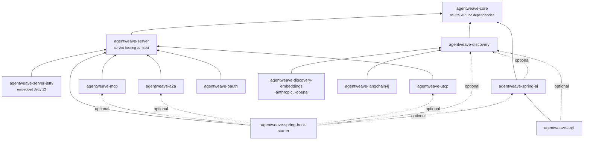

# Architecture

AgentWeave is a small, protocol-neutral core with one module per protocol on top of it. Framework
integrations sit on top of those, and nothing depends on them.

## Modules

Each module also depends on its own third-party library (the MCP Java SDK, a2a-java, Jackson 3,
Nimbus, LangChain4j, Spring AI, ARGI, Spring Boot), as listed below. `agentweave-argi-neutral`, which
depends on the core and optionally on discovery, is left out of the diagram: it isn't published
and isn't part of the default build.

| Module | Responsibility | Depends on |
|---|---|---|
| `agentweave-core` | Tool, agent, auth, progress, observation, error and compliance types. | Nothing |
| `agentweave-server` | `ServerEndpointProvider`, `ServletEndpoint` and `InboundAuthFilter`: how protocol servers hand HTTP endpoints to a host. | core; servlet API provided by the host |
| `agentweave-server-jetty` | `AgentWeaveServer`, an embedded Jetty 12 (Jakarta EE 11, Servlet 6.1) host. | server, Jetty |
| `agentweave-mcp` | `McpClientConnector`, `McpToolServer`, `McpResources`, `McpPrompts`. | server, MCP Java SDK |
| `agentweave-a2a` | `A2aAgentConnector`, `A2aAgentServer`. | server, a2a-java client, server-common and JSON-RPC transport |
| `agentweave-utcp` | `UtcpClientConnector`, `UtcpManualProvider`. | server, Jackson 3 (internal), `java.net.http` |
| `agentweave-oauth` | [OAuth 2.1](../integrations/oauth.md): `OAuthClient` (an `HttpAuthorizer`), `BearerTokenAuthenticator`, `ProtectedResourceMetadataEndpoint`. | server, Nimbus (internal) |
| `agentweave-discovery` | [Tool discovery](../discovery/index.md): `CapabilityCatalog`, search, fallback, meta-tools. | core |
| `agentweave-discovery-embeddings` | Semantic ranking: offline or LangChain4j `EmbeddingModel` embedders. | discovery, LangChain4j core |
| `agentweave-discovery-anthropic`, `agentweave-discovery-openai` | Typed native tool-search adapters. | discovery, the provider's Java SDK |
| `agentweave-langchain4j` | `AgentWeaveToolProvider`, `LangChain4jAgents`, `LangChain4jTools`, `CatalogToolSearchStrategy`. | core, discovery, LangChain4j |
| `agentweave-spring-ai` | [Spring AI](../integrations/spring-ai.md): `AgentWeaveToolCallbacks`, `CatalogToolIndex`, `SpringAiAgents`, `SpringAiTools`. | core, `spring-ai-model`; Spring AI chat client, tool search and discovery optional |
| `agentweave-argi` | [ARGI 2.1.0-RC1](../integrations/argi.md): `ArgiTools`, `CatalogToolSelectionInterceptor`, `ArgiAgents`. | spring-ai, ARGI agent framework; discovery optional |
| `agentweave-argi-neutral` | ARGI's Spring-free API: `ArgiNeutralTools`, `CatalogToolSelectionInterceptor`, `ArgiNeutralAgents`. **Not published**; built only with `-PargiSnapshot`. | core, ARGI `argi-api` and `argi-agent-api` snapshot; discovery optional |
| `agentweave-spring-boot-starter` | Auto-configuration, properties, Micrometer and Actuator. | server; protocol modules, discovery, Spring AI and Spring are `compileOnly` |
| `agentweave-bom` | Version alignment of the published modules. | — |

## Dependency rules

- **The core depends on nothing.** It holds no protocol, JSON, servlet or telemetry types.
- **Each protocol module depends on the core, the hosting contract and its own SDK.** SDK types
  never appear in a public signature, and the SDK is an `implementation` dependency, so it doesn't
  leak onto your compile classpath. The servlet API is `compileOnly`: the host provides it.
- **Protocol modules don't depend on each other.** An A2A agent becomes a tool through the core's
  `ToolConnector` interface, not through a dependency on an MCP module.
- **The core, the protocol modules and discovery don't depend on the framework integrations.**
  Plain Java and other agent frameworks use the core and a protocol module directly. Integrations
  may build on each other: the ARGI RC1 adapter reuses the Spring AI adapter, because ARGI RC1 is
  built on Spring AI. The Spring Boot starter declares the protocol modules, discovery and the
  Spring AI adapter `compileOnly`; you add the ones you use.
- **OAuth is optional and protocol-neutral.** `HttpAuthorizer` lives in the core, so the MCP
  module accepts an authorizer without depending on `agentweave-oauth`.

## The core API

| Area | Types | Page |
|---|---|---|
| Tools | `ToolSource`, `ToolConnector`, `ToolSpec`, `ToolInvocation`, `ToolOutcome`, `Content`, `ToolRegistry`, `LocalTools`, `@AgentTool`, `@ToolParam`, `ToolHandler`, `ProgressAwareToolHandler`, `ToolProgress` | [Tools and the registry](tools.md) |
| Agents | `AgentConnector`, `AgentHandler`, `AgentTaskContext`, `AgentRequest`, `AgentMessage`, `AgentReply`, `AgentEvent`, `AgentArtifact`, `AgentDescriptor`, `TaskState` | [Agents](agents.md) |
| Security | `CredentialProvider`, `Credential`, `HttpAuthorizer`, `InboundAuthenticator`, `InboundRequest`, `AuthDecision`, `CallerIdentity` | [Security and credentials](security.md) |
| Errors and telemetry | `AgentWeaveException`, `ErrorCategory`, `ObservationHandler` | [Errors and observability](errors-and-observability.md) |
| Connectors | `ProtocolConnector`, `ProtocolId`, `ComplianceReport` | [Versions and compliance](compliance.md) |

Every connector is a `ProtocolConnector`: it is built by a protocol-specific builder, started
explicitly with `start()`, and closed with `close()` (safe to call more than once). Tool connectors
(MCP, UTCP, and A2A's `ask` tool) also implement `ToolConnector`; the A2A connector additionally
implements `AgentConnector`.

The core API is blocking. The MCP SDK is reactive internally; AgentWeave uses its synchronous
facade on the client and keeps Reactor off the public API.

## How servers are hosted

Protocol servers don't start an HTTP server themselves. Each one is a `ServerEndpointProvider`
that returns `ServletEndpoint`s: a name, the protocol, URL patterns, a servlet, and whether it
needs async support.

| Server | Endpoints (default paths) | Async |
|---|---|---|
| `McpToolServer.Http` | `/mcp` | yes |
| `A2aAgentServer` | `/.well-known/agent-card.json`, `/a2a` | yes |
| `UtcpManualProvider` | `/utcp`, `/utcp/*` | no |
| `ProtectedResourceMetadataEndpoint` (`agentweave-oauth`) | `/.well-known/oauth-protected-resource/<resource path>`, optionally the root well-known URI | no |

A host mounts every endpoint and puts an `InboundAuthFilter` in front of it, so one
`InboundAuthenticator` protects all protocols. Two hosts are provided:

- [`AgentWeaveServer`](../integrations/jetty.md) (embedded Jetty) for plain Java.
- The [Spring Boot starter](../integrations/spring-boot.md), which registers the endpoints on
  Boot's servlet container.

Any other Jakarta Servlet 6 container works the same way: register each endpoint's servlet on its
URL patterns, add an `InboundAuthFilter` on the same patterns, and enable async support on both
when `asyncSupported()` is true.

## Design records

The design decisions behind each module, with their sources, are kept as specs in the
repository: `goal-and-requirements.md`, `architecture.md`, and a `SPEC.md` in each module
directory. When this site and a module's `SPEC.md` disagree, the `SPEC.md` and the code are
authoritative.
